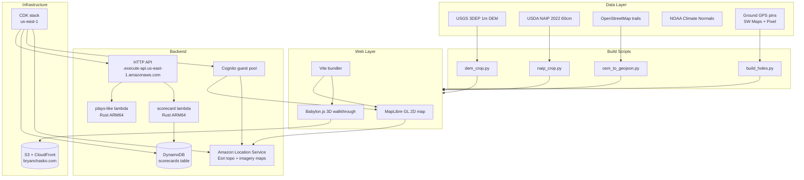

# cloudcroft disc golf

a virtual walkthrough of two disc golf courses in cloudcroft, new mexico, built from a ground survey on november 1, 2026.

live at:

- story + how-it-works: https://bryanchasko.com/cloudcroft-disc-golf/
- 2d map: https://bryanchasko.com/cloudcroft-disc-golf/app/
- 3d walkthrough: https://bryanchasko.com/cloudcroft-disc-golf/app/walk.html

built for the AWS Builder Center Weekend Challenge "Map it" (october 30–november 2, 2026). submission draft: [`docs/submission-draft.md`](docs/submission-draft.md).

this repo is the public export of the private build repo `chasko-labs/cloudcroft-disc-golf` (see `export-public.sh`). the private repo holds the working tree, survey originals, and deploy credentials; everything here is sanitized for public use.

## what this is

two public courses in a mountain village at 8,676 ft:

| course                        | holes | par | length               |
| ----------------------------- | ----- | --- | -------------------- |
| Byron Ligon Memorial Tiki DGC | 9     | 27  | 901 ft               |
| Cloudcroft Community DGC      | 18    | 63  | awaiting full survey |

the tiki course is a putting course under aspen and doug fir — every hole is par 3, the longest is 134 ft. ray haller built both courses by hand. the community course winds through pines on the north side of town.

this project lets you walk the courses from a browser: a 2d map with surveyed pins, trail overlays, and a working scorecard, plus a 3d walkthrough built on 1 m elevation data and 2022 aerial imagery.

## architecture



## how it works

### data layer

the terrain comes from a single USGS 3DEP 1 m DEM tile that covers both courses. the naip 2022 60 cm imagery tile drapes over it. trails are an OpenStreetMap bounding-box extract via Overpass API. elevation at each surveyed point samples directly from the DEM.

the ground survey on november 1 produced 27 GPS points on the community course (tees, baskets, fairway positions) and 6 unidentified points on the tiki course, all collected in SW Maps with multi-fix averaging. pixel phone photos and 360 panoramas were taken at the same positions.

### build scripts

python scripts in `dataset/scripts/` turn raw data into bundled assets:

| script              | input                 | output                                   |
| ------------------- | --------------------- | ---------------------------------------- |
| `dem_crop.py`       | USGS 3DEP tile        | `course-area-grid.json` mesh             |
| `naip_crop.py`      | NAIP tile             | `course-area-naip.jpg` overlay           |
| `osm_to_geojson.py` | Overpass JSON         | `trails.geojson`                         |
| `build_holes.py`    | SW Maps GeoJSON + DEM | hole files with elevation and plays-like |

run the full pipeline:

```bash
cd dataset
python scripts/dem_crop.py
python scripts/naip_crop.py
python scripts/osm_to_geojson.py
python scripts/build_holes.py
```

### web layer

the 2d map runs on MapLibre GL with Amazon Location Service base maps (Esri topo and imagery). a Cognito guest pool gives anonymous access to map tiles and the place index. surveyed pins, trail overlays, and the naip window layer on top. the scorecard posts to the rust lambda.

the 3d walkthrough uses Babylon.js. a 200x200 mesh from the 1 m DEM forms the terrain, draped with the naip image. instanced trees approximate the forest — illustrative, not surveyed. course pins and windsocks mark the anchors. wasd walk, orbit, and a pano viewer for each 360 photo from the field day.

### backend

two rust lambdas behind an HTTP API:

| endpoint      | method | purpose                                                           |
| ------------- | ------ | ----------------------------------------------------------------- |
| `/plays-like` | GET    | horizontal distance + elevation change + adjusted plays-like feet |
| `/scorecard`  | GET    | fetch all entries for a round                                     |
| `/scorecard`  | POST   | store a score entry                                               |

the plays-like formula (v0): uphill adds the full climb, downhill credits half the drop. calibrate against ground truth as more holes get surveyed.

scorecard entries go to a DynamoDB table with `round_id` as partition key and `entry` as sort key. `entry` is either `meta` (round header) or `hole#NN` (hole score). no user login — rounds are client-generated uuids stored in localStorage.

### infrastructure

one CDK stack in `infra-cdk/` owns everything: Location Service resources (two maps, place index, geofence collection, tracker, route calculator), Cognito identity pool, two lambdas, HTTP API, DynamoDB table. deployed to us-east-1 in account `<ACCOUNT_ID>`.

the web bundle syncs to S3 under the existing bryanchasko.com CloudFront distribution. no separate bucket or distribution — just a new prefix.

## data provenance

| dataset                                  | used | fetch path                            | Registry of Open Data on AWS                                           | license / attribution                            |
| ---------------------------------------- | ---- | ------------------------------------- | ---------------------------------------------------------------------- | ------------------------------------------------ |
| USGS 3DEP 1 m DEM, NM_SouthEast_2018_D19 | yes  | tile staged in project bucket         | no — registry entry is lidar point clouds, not the DEM product we used | United States government public domain           |
| USGS NAIP 2022 60 cm, m_3210503_nw       | yes  | state QQ shapefile index, staged tile | listed, but we fetched via a different path                            | public domain with attribution; credit USDA NAIP |
| OpenStreetMap                            | yes  | live Overpass API bbox extract        | listed, but we used the API not the registry bucket                    | ODbL; (c) OpenStreetMap contributors             |
| NOAA U.S. Climate Normals 1991-2020      | yes  | s3://noaa-normals-pds station CSV     | **yes** — genuine registry fetch                                       | NOAA NCEI; no endorsement implied                |

the only proven Registry-of-Open-Data-on-AWS fetch in the shipped outputs is the NOAA normals file. the rest are public/open data obtained through other paths.

## survey method

GPS points were collected with SW Maps on a Pixel phone, using multi-fix averaging at each position:

| metric              | typical range                 |
| ------------------- | ----------------------------- |
| horizontal accuracy | 4–14 m                        |
| averaging           | 30–55 fixes per point         |
| elevation source    | DEM sample at GPS coordinates |

pixel photos and 360 panoramas carry EXIF GPS from the same device. the panorama viewer shows the horizon at each surveyed viewpoint — what you would see standing on that spot.

## plays-like and scorecard api

### plays-like

```bash
curl "https://<API_ID>.execute-api.us-east-1.amazonaws.com/plays-like?from_lat=32.96&from_lon=-105.74&from_ele_ft=8664&to_lat=32.96&to_lon=-105.74&to_ele_ft=8700"
```

response:

```json
{
  "horizontal_ft": 364.8,
  "elev_change_ft": 36.0,
  "plays_like_ft": 400.8,
  "model": "v0-uphill-full-downhill-half"
}
```

### scorecard

start a round:

```bash
curl -X POST "https://<API_ID>.execute-api.us-east-1.amazonaws.com/scorecard" \
  -H "content-type: application/json" \
  -d '{"round_id":"device123-20261101","entry":"meta","course":"tiki","device_id":"device123","started_at":"2026-11-01T10:00:00Z"}'
```

record a hole:

```bash
curl -X POST "https://<API_ID>.execute-api.us-east-1.amazonaws.com/scorecard" \
  -H "content-type: application/json" \
  -d '{"round_id":"device123-20261101","entry":"hole#1","hole":1,"strokes":3,"putts":1}'
```

fetch the round:

```bash
curl "https://<API_ID>.execute-api.us-east-1.amazonaws.com/scorecard?round_id=device123-20261101"
```

## running locally

clone the repo, install dependencies, and start the dev server:

```bash
git clone https://github.com/BryanChasko/cloudcroft-disc-golf-public.git
cd cloudcroft-disc-golf-public/web
npm install
npm run dev
```

the map expects Amazon Location Service credentials. for local development without AWS access, the bundled data copies in `web/public/data/` suffice for the surveyed pins and terrain.

## rerunning the dataset pipeline

the raw data lives in `dataset/`:

```bash
cd dataset

# terrain mesh from DEM
python scripts/dem_crop.py

# naip imagery crop
python scripts/naip_crop.py

# osm trails
python scripts/osm_to_geojson.py

# hole files with elevation + plays-like
python scripts/build_holes.py

# run tests
pytest scripts/tests/
```

the pipeline is idempotent — re-running after new GPS points land produces updated hole files without manual steps.

## media

curated copies of the already-published images live in [`visuals/`](visuals/) with one-line provenance captions.


<!-- gallery images slot in here once dataset/media-manifest.json exists -->

## limits

the community course has holes 1–2 fully surveyed. hole 3 has a photographed basket but no surveyed tee. the remaining 15 holes have anchors from aerial imagery but no ground truth.

the tiki course has 6 surveyed points, but none are identified to a specific hole. hole distances come from the Radius Disc Golf listing, not from ground GPS.

the 3d forest is illustrative — random tree instances, not a surveyed canopy. the panorama viewer shows the real view; the walk view shows an approximation.

## show and tell

this section demonstrates the technical stack with real examples. full AWS MCP captures are in [`aws-mcp-captures.md`](aws-mcp-captures.md).

### graviton lambdas

the two rust lambdas run on ARM64 (Graviton) under the `provided.al2023` custom runtime. here is the MCP call shape and a real `GetFunctionConfiguration` return (trimmed):

```python
# AWS MCP run_script call pattern
result = await call_boto3(
    service_name='lambda',
    operation_name='GetFunctionConfiguration',
    region_name='us-east-1',
    params={'FunctionName': 'cloudcroft-disc-golf-plays-like'}
)
```

```json
{
  "FunctionName": "cloudcroft-disc-golf-plays-like",
  "Runtime": "provided.al2023",
  "Handler": "bootstrap",
  "MemorySize": 128,
  "Timeout": 10,
  "Architectures": ["arm64"]
}
```

**Why static musl on ARM64:** the cross gnu image links glibc 2.38+, but Amazon Linux 2023 ships glibc 2.34. static musl binaries have no libc dependency — they run everywhere. the build script in `scripts/build-lambda-assets.sh` uses `aarch64-unknown-linux-musl` for this reason.

### infrastructure as code

all resources live in one CDK stack (`infra-cdk/lib/cloudcroft-disc-golf-stack.ts`). lambda definition:

```typescript
const playsLike = new lambda.Function(this, "PlaysLike", {
  functionName: "cloudcroft-disc-golf-plays-like",
  runtime: lambda.Runtime.PROVIDED_AL2023,
  architecture: lambda.Architecture.ARM_64,
  handler: "bootstrap",
  code: lambda.Code.fromAsset(
    path.join(__dirname, "..", "assets", "plays-like"),
  ),
  memorySize: 128,
  timeout: cdk.Duration.seconds(10),
  description: "Hackathon: plays-like distance v0",
});
```

dynamo table definition:

```typescript
const scorecards = new dynamodb.Table(this, "Scorecards", {
  tableName: "cloudcroft-disc-golf-scorecards",
  partitionKey: { name: "round_id", type: dynamodb.AttributeType.STRING },
  sortKey: { name: "entry", type: dynamodb.AttributeType.STRING },
  billingMode: dynamodb.BillingMode.PAY_PER_REQUEST,
  removalPolicy: cdk.RemovalPolicy.RETAIN,
  pointInTimeRecovery: true,
});
```

### build standards

rust lambdas are cross-compiled from x86_64 to ARM64 using `cross`. the build script handles the musl static linking:

```bash
#!/usr/bin/env bash
# Build Rust lambda assets for the CDK stack (static musl ARM64 via cross).
# musl, not gnu: the cross gnu image links glibc 2.38+ but provided.al2023
# ships glibc 2.34, which fails at init. Static binaries have no libc dep.
set -euo pipefail
cd "$(dirname "$0")/../backend"

for crate in plays-like scorecard; do
  echo "=== $crate ==="
  cross build --target aarch64-unknown-linux-musl --release --package "$crate"
  out="../infra-cdk/assets/$crate"
  mkdir -p "$out"
  cp "target/aarch64-unknown-linux-musl/release/$crate" "$out/bootstrap"
done
echo "assets ready under infra-cdk/assets/"
```

**Key points:**

- `cross` for cross-compilation from x86_64 dev machine to ARM64 target
- `aarch64-unknown-linux-musl` — static binary, no glibc dependency
- output: `infra-cdk/assets/<crate>/bootstrap` — CDK zips the directory for Lambda

### test standards

rust unit tests run inline in the lambda source. example from `backend/plays-like/src/main.rs`:

```rust
#[cfg(test)]
mod tests {
  #[test]
  fn same_point_is_zero() {
    assert_eq!(haversine_ft(32.95787, -105.73887, 32.95787, -105.73887), 0.0);
  }

  #[test]
  fn uphill_adds_full_climb() {
    assert_eq!(plays_like_ft(300.0, 40.0), 340.0);
  }

  #[test]
  fn downhill_credits_half_drop() {
    assert_eq!(plays_like_ft(300.0, -80.0), 260.0);
  }
}
```

run tests:

```bash
cd backend
cargo test --workspace
```

**CI posture:** CodeBuild is retired. checks run locally before push — lint, rust tests, CDK synth. no GitHub Actions. the zero-budget policy means CI lives on the build machine, not in a hosted pipeline.

## license

code: MIT
docs and media: CC-BY 4.0

## credits

- USGS 3DEP for the 1 m elevation data
- USDA NAIP for the 2022 aerial imagery
- OpenStreetMap contributors for trail data
- NOAA National Centers for Environmental Information for the Cloudcroft climate normals
- Radius Disc Golf for the Tiki course hole distances
- Ray Haller for building both courses
